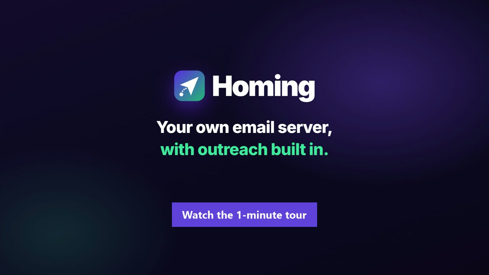
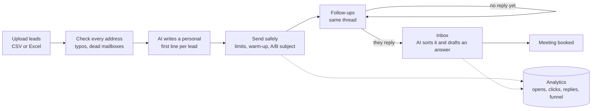
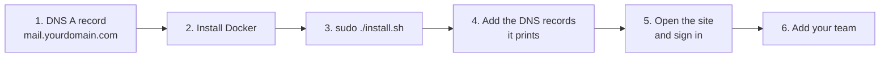
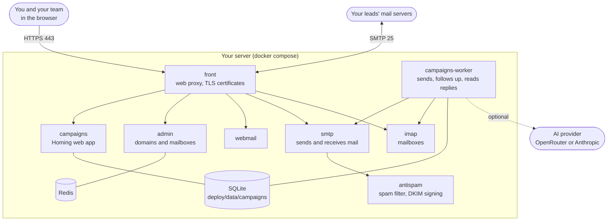

<p align="center">
  
</p>

<h1 align="center">Homing</h1>

<p align="center">
  Your own email server with outreach built in.<br>
  Upload leads, let AI write each email, follow up automatically, and answer every reply from one inbox.
</p>

<p align="center">
  <a href="media/homing-explainer.mp4"></a>
</p>

---

Named after homing pigeons: your emails go out, the replies find their way
back. Everything runs on one server you own. Your contacts, your mail and
your API keys never leave it.

## How it works



## Features

| | |
|---|---|
| **Leads** | Upload a CSV or Excel file. Every column can be used in the email. A pipeline tracks each lead from new to won. |
| **AI writing** | A personal opening line, or a full rewrite, for every lead. It only uses facts it was given and never adds links. |
| **Sequences** | The first email plus follow-ups: "wait 3 days, then reply in the same thread if they have not answered". |
| **Subject tests** | Two subject lines; the one that gets more replies goes to the rest of the list. |
| **Address checks** | Bad domains, throwaway mailboxes and typos like `gmial.com` are caught before anything is sent. |
| **Inbox** | Replies matched to the lead, sorted by AI (interested, meeting, not interested…), answered in the same thread. |
| **Calendar** | Follow-up tasks and scheduled sends, with a feed for Google, Outlook and Apple calendars. |
| **Safe sending** | Hourly and daily limits, sending windows and a warm-up plan. Pauses itself on high bounce or spam rates. |
| **Analytics** | Opens, clicks, replies and bounces per campaign, follow-up, list and account, plus a funnel to booked meetings. |
| **AI agent** | Ask in plain words: "write a follow-up for my dentist list and send it tomorrow at 10". You approve before it sends. |
| **Domain setup** | Every DNS record with a copy button and live check. With a Cloudflare token it adds them for you. |
| **API and webhooks** | Send transactional email from your own apps. |

## Deploy

**You need:** a Linux VPS with 2 GB RAM or more, a domain, and outgoing
port 25 open. Many providers block port 25 on new servers; ask their support
to open it first.



**1. Point your domain at the server.** Add a DNS `A` record:
`mail.yourdomain.com` → your server's IP address.

**2. Install Docker** (skip if it is already installed):

```bash
curl -fsSL https://get.docker.com | sudo sh
```

**3. Install Homing:**

```bash
git clone https://github.com/ibrahembuilds/homing-mail.git homing
cd homing/deploy
sudo ./install.sh
```

It asks for your domain, product name and brand colour, then starts
everything and prints:

- the admin password,
- your sending address (`hello@yourdomain.com`),
- the DNS records to add.

Already running Coolify on the server? The installer notices and plugs into
Coolify's proxy instead of taking ports 80 and 443: Coolify serves the website
and its certificate, and Homing opens only the mail ports (25, 465, 587, 993).
Your other apps are not touched. Point `mail.yourdomain.com` at the server
before you install; if it does not resolve yet, the installer keeps the website
off (an early certificate request would fail and Let's Encrypt locks the name
for an hour after five failures) and tells you to run it again once it does.

**4. Add the DNS records** it printed at your domain registrar. Or open
**Homing → Domain & DNS**, paste a Cloudflare token, and it adds them for you.
Then set the reverse DNS (PTR) of your server's IP to `mail.yourdomain.com`
in your VPS provider's panel.

**5. Open `https://mail.yourdomain.com/`**, sign in as `admin@yourdomain.com`
(the owner), and in **Settings** add your postal address and an AI key
(OpenRouter or Anthropic). Turn on warm-up before your first large send.

**6. Add your team** under **Homing → Team**. Each person gets their own
sign-in (a mailbox on your server, created for them) and one of three roles:

| Role | Can |
|---|---|
| Member | Leads, campaigns, inbox, calendar, AI agent, analytics |
| Admin | Also settings, domain, sending accounts, API keys, and adding members |
| Owner | Everything, including adding and removing admins and owners |

That's it.

| Address | What it is |
|---|---|
| `https://mail.yourdomain.com/` | Homing: leads, campaigns, inbox, analytics, AI agent, team |
| `https://mail.yourdomain.com/admin` | Mail admin: domains and mailboxes |
| `https://mail.yourdomain.com/webmail` | Webmail |

### What runs on your server



### Day to day

Run these from the `deploy` folder:

```bash
./manage.sh status                     # is everything running, is mail moving
./manage.sh update                     # newest version; keeps your data and settings
./manage.sh backup                     # saves everything to backups/<date>.tar.gz
./manage.sh restore backups/<file>     # puts a backup back
./manage.sh logs campaigns             # follow one service's log
./manage.sh add-mailbox sales@yourdomain.com
./manage.sh help                       # all commands
```

Copy your backups off the server. Everything that matters is in
`deploy/data/` and `deploy/homing.env`.

### Settings

All settings are in `deploy/homing.env`. Edit the file, then run
`sudo ./install.sh` again to apply your changes. Your data and passwords are
kept.

| Setting | |
|---|---|
| `BRAND_NAME`, `SITENAME` | Product name shown everywhere |
| `BRAND_COLOR`, `LOGO_BACKGROUND` | Brand colour, for example `#5b3be8` |
| `CAMPAIGNS_WEBHOOK_PRIVATE=1` | Allow webhooks to addresses on your own network (for example a self-hosted n8n) |

To use your own logo, replace the files in `branding/static/`, keeping the
same names. Or generate new ones:
`python3 branding/make_icons.py --name "Your Brand" --color "#5b3be8"`.

## Getting into the inbox

No setting makes providers accept unwanted mail. What Homing does is make
the parts that matter easy to get right:

- **Authentication:** SPF, DKIM, DMARC and reverse DNS, checked for you.
- **Warm-up:** a new server starts at 50 emails a day and grows 50% daily.
- **Clean lists:** bounces and spam complaints are never mailed again.
- **One-click unsubscribe** in every campaign. It cannot be turned off.
- **Content check:** flags patterns that land in junk, and scores each email with the server's spam filter.

Only email people who agreed to hear from you. Bought or scraped lists are
illegal to mail in most countries and get a domain blocked within days.

## Send API

Create a key in **Settings → API keys**.

```bash
curl https://mail.yourdomain.com/campaigns/api/emails \
  -H "Authorization: Bearer em_..." \
  -H "Content-Type: application/json" \
  -d '{"from": "Shop <orders@yourdomain.com>", "to": "buyer@example.com",
       "subject": "Your order", "html": "<p>Thanks!</p>"}'
```

| Endpoint | |
|---|---|
| `POST /campaigns/api/emails` | Send one email (`from`, `to`, `subject`, `html`, `text`, `cc`, `bcc`, `reply_to`, `headers`, `tags`, `scheduled_at`) |
| `POST /campaigns/api/emails/batch` | Up to 100 emails |
| `GET /campaigns/api/emails/<id>` | Status and events |
| `POST /campaigns/api/emails/<id>/cancel` | Cancel a scheduled email |
| `POST /campaigns/api/contacts` | Create or update a contact |
| `GET /campaigns/api/lists` | Contact lists |
| `GET /campaigns/api/campaigns/<id>` | Campaign results |

Webhooks (**Settings → Webhooks**) send `email.sent`, `opened`, `clicked`,
`bounced`, `complained`, `unsubscribed` and `failed` events, signed with
`X-Webhook-Signature: sha256=HMAC(secret, timestamp + "." + body)`.

## Run it on your computer

To try Homing without a server: no Docker needed, and emails are printed
instead of sent.

```bash
cd campaigns
pip install -r requirements.txt
python run.py --smtp-debug
```

Open the address it prints and sign in with the password it prints.

Run the tests with `pip install pytest && python -m pytest tests -q`.

## Licence

MIT © 2026 Ibrahim. See [LICENSE.md](LICENSE.md) and [THIRD-PARTY.md](THIRD-PARTY.md).
